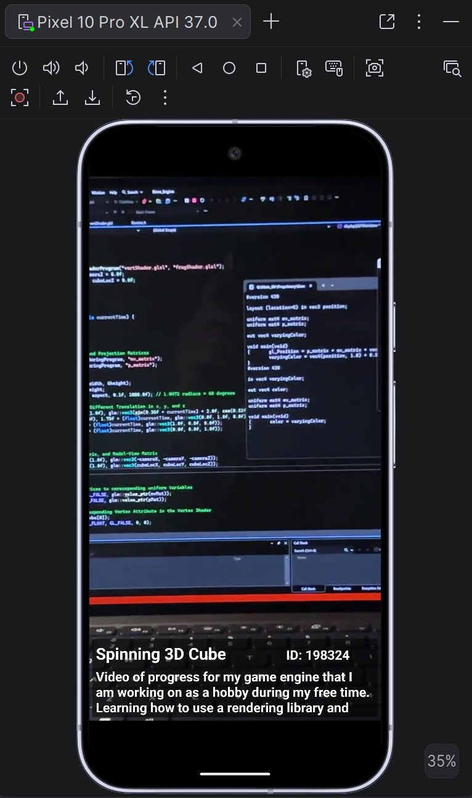
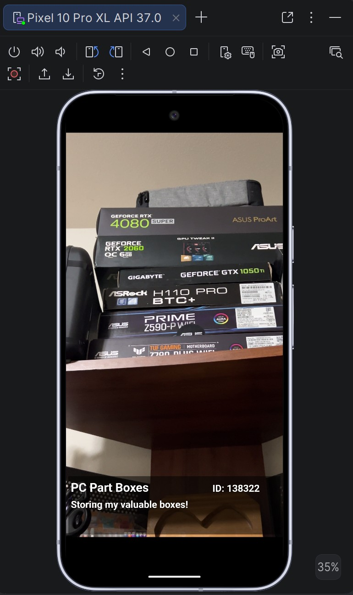
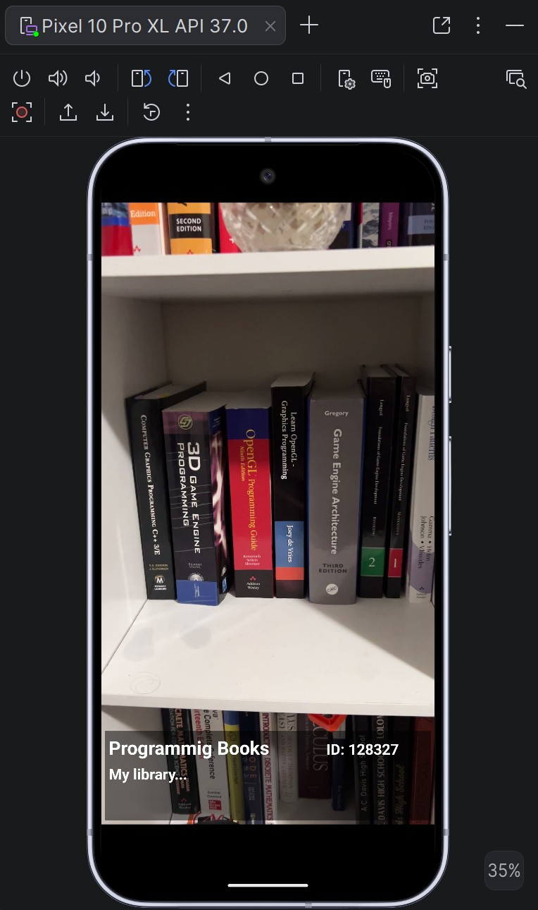

# LAB 2 - CWU CS460: Swipe Video Application
## About: 
##### This is an Android application built using Android Studio that performs basic swipe and video playback features using the model-view-controller concept. It is implemented based on Professor Dr. Shangyue Zhu's lectures on creating the core part of the application along with the lab rubric requirements for the assignment.

## Functionality: 
##### Allows for swiping up and down for multiple video playback. Includes a scrollable description field that contains the video data on it.

### Screenshot 1 (App Icon):

### Screenshot 2 (Video 2):

### Screenshot 3 (Video 3):

### Screenshot 4 (Video 4):

### DEMO (Video):

<a href="https://www.youtube.com/watch?v=isvWAGl1zJE">( Video Link )</a>
